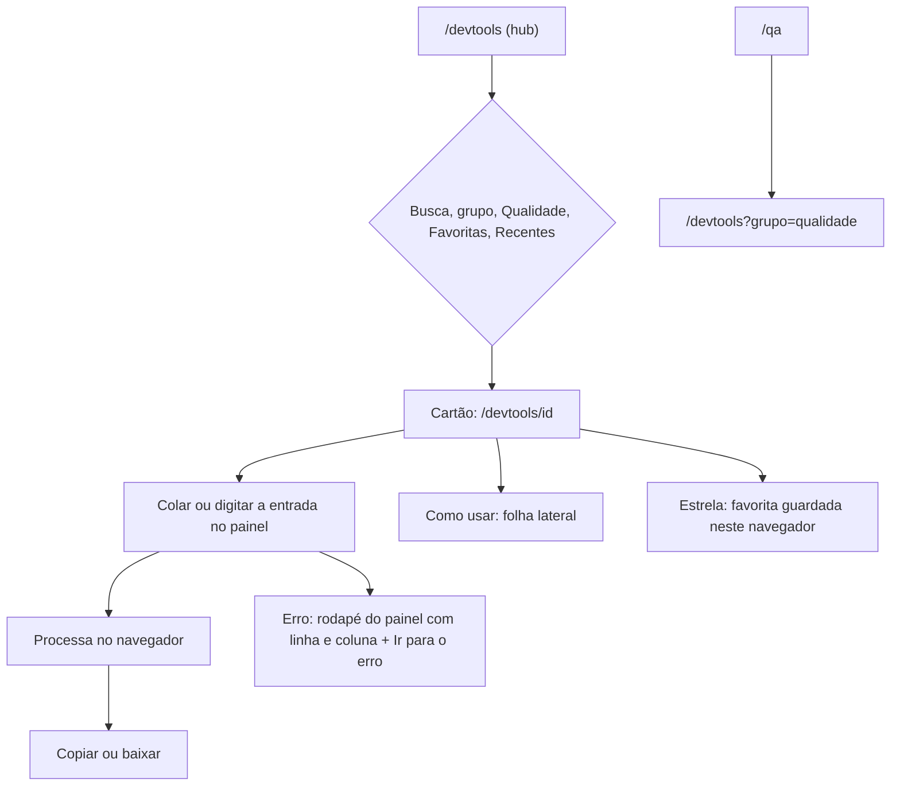

# DevTools

## Objetivo e quem usa

Caixa de ferramentas do dia a dia: formatar e converter dados, decodificar JWT, testar regex, gerar massa de dados, montar chamadas de API e apoiar o teste. A maioria **roda no navegador, sem enviar o conteúdo a servidor**; as que usam um serviço externo trazem um **selo** no cartão, um **aviso com o nome do serviço** no topo da ferramenta e aparecem na lista do **Guia** do hub. O subtítulo do hub não promete mais que "nada sai da máquina".

- Qualquer pessoa **logada** usa. Não há papel nem guarda de rota além do login geral (`AuthGuard`; só `/login` é público). Nenhuma ferramenta expõe dados internos do Portal: a única que fala com o servidor do Portal é o **Zephyr** (via Jira).
- A antiga **Central de qualidade** (`/qa`) **deixou de ser um módulo**: virou o filtro **Qualidade** desta tela. `/qa` continua existindo só para redirecionar a `/devtools?grupo=qualidade`.

## Telas

| Tela | Caminho | O que é |
|---|---|---|
| Hub | `/devtools` | Busca (tecla `/` foca), pílulas dos 5 grupos + **Qualidade** + **Favoritas** + **Recentes**, cartões com selo, seções "Favoritas" e "Recentes" no topo da aba Todas (recentes: no máximo 4) e o **Guia** (folha lateral) |
| Filtro Qualidade | `/devtools?grupo=qualidade` | As 12 ferramentas de teste e apoio à qualidade, de vários grupos. `?grupo=` aceita `dados`, `codificacao`, `texto`, `rede`, `testes`, `qualidade`, `favoritas`, `recentes` |
| Ferramenta | `/devtools/{id}` | Casca única (`DevToolPage`): ícone do módulo, migalha "DevTools › Grupo › Ferramenta", selo de onde roda, estrela de favorita, "Como usar" em folha lateral, aviso de serviço externo (quando houver) e corpo na largura e altura da página (`wide`) |
| Ferramentas fundidas | `/devtools/{id}?aba=` | `data-studio` (`formatar`, `converter`, `schema`), `encoding` (`base64`, `url`, `camadas`), `diff` (`texto`, `json`, `contrato`), `test-data` (`gerar`, `validar`). Aba desconhecida cai na primeira; trocar de aba atualiza a URL |

O catálogo vive em um registro só (`src/lib/devtools/registry.ts`): id, título, descrição, grupo, ícone, `qa`, palavras de busca, passos do "Como usar", `network` (host, o que sai, aviso e texto do selo) e `tabs`. **Não existe mais o status `soon`** nem "N em breve". Um teste confere que cada id tem sua pasta em `src/app/devtools/`.

## Fluxo principal

## Catálogo (25 ferramentas em 5 grupos)

**Dados e formatos (3):** **Estúdio de Dados** (JSON, XML, YAML e SQL em três abas: Formatar, Converter e Schema), Planilha para CSV (lê `.xlsx` no navegador, **limite de 20 MB** com mensagem), Markdown.
**Codificação e segurança (4):** **Codificação** (Base64, URL e Camadas), JWT Inspector (só decodifica, não valida assinatura), Certificados, Cofre de Segredos.
**Texto e tempo (8):** Regex Lab, **Diff** (Texto, JSON e Contrato de API com asserções), String Master, Gerador de Tipos, Cron, Data e Hora, UUID e IDs, Calculadoras.
**API e rede (4):** Cliente HTTP, Snippets de API, IP Analyzer, Consulta de CEP.
**Qualidade e testes (6):** **Massa de Dados** (Gerar e Validar, com conjuntos salvos; reúne a antiga Massa de Dados e o CPF e CNPJ), Zephyr Explorer, BDD e Bugs, Gerador de Automação, Fuzz de Limites, Gerador JUnit.

**Filtro Qualidade (12):** Estúdio de Dados, JWT Inspector, Regex Lab, Diff, UUID e IDs, Cliente HTTP, Massa de Dados, Zephyr Explorer, BDD e Bugs, Gerador de Automação, Fuzz de Limites, Gerador JUnit.

### Rotas antigas (redirecionam, links salvos continuam funcionando)

| Rota antiga | Vai para |
|---|---|
| `/devtools/json`, `/devtools/xml`, `/devtools/sql-formatter` | `/devtools/data-studio?aba=formatar&formato=json\|xml\|sql` |
| `/devtools/yaml-converter` | `/devtools/data-studio?aba=converter&de=yaml&para=json` |
| `/devtools/json-schema` | `/devtools/data-studio?aba=schema` |
| `/devtools/base64`, `/devtools/url-encoder`, `/devtools/deep-decoder` | `/devtools/encoding?aba=base64\|url\|camadas` |
| `/devtools/api-diff` | `/devtools/diff?aba=contrato` |
| `/devtools/doc-generator` | `/devtools/test-data?aba=gerar&tipo=cpf` |
| `/devtools/mocks` (removida) | `/devtools` |
| `/qa` | `/devtools?grupo=qualidade` |

A lógica das ferramentas não foi reescrita: o que estava dentro das páginas foi movido sem mudar o algoritmo para `src/lib/devtools/` (`format-data.ts`, `sql-format.ts`, `json-schema.ts`, `encoding.ts`, `api-contract.ts`, `mass-data.ts`, `test-data-generators.ts`, `br-docs.ts`).

### O que a fusão mudou na interface

- **Massa de Dados:** o modo "Individual" (cartões de CPF, CNPJ, cartão e perfil) virou um lote de 1; o lote vai de 1 a 1.000 (antes 500, e 100 para documentos), a saída é CSV, JSON ou SQL, e CNPJ tem formato numérico ou alfanumérico e "mesma raiz, filiais". O botão "Criar mock" saiu junto com o Estúdio de Mocks.
- **Estúdio de Dados:** YAML ganhou "Formatar" (relê e reescreve) e a conversão passou a aceitar YAML ↔ XML (via JSON).
- **Diff:** a aba "Contrato de API" mantém as duas funções (comparar o primeiro nível do JSON e gerar asserções para Postman, Cypress e Playwright).

## O que sai do navegador

| Ferramenta | Para onde vai | O que é enviado | Risco |
|---|---|---|---|
| **Consulta de CEP** | `viacep.com.br` (direto do navegador) | O CEP digitado | Baixo |
| **IP Analyzer** ("Localizar") | `ipapi.co` | O IP consultado (ou o do próprio usuário) | Baixo; a tela avisa. CIDR e máscara são locais |
| **Cliente HTTP** | A URL digitada, direto do navegador | Método, URL, cabeçalhos e corpo informados | A CSP só libera alguns destinos (ver "Pontos frágeis") |
| **Zephyr Explorer** | Backend Spring `POST /api/jira/testcase`, que chama o Jira do usuário | Código do caso, domínio do Jira e o **PAT** do usuário | PAT passa pelo servidor do Portal; o servidor só lê, valida o domínio e o código (`[A-Za-z0-9_-]{1,60}`) |
| **Gerador JUnit** (Gemini, opcional; selo "Serviço externo opcional") | Google Gemini, direto do navegador | A **classe Java colada** e a chave do próprio usuário | **A chave fica em `localStorage` em texto puro** (a tela agora avisa com destaque). O motor local não envia nada |

Guardam dados no navegador (`localStorage`): favoritas (`agile-devtools:fav:{usuário}`), recentes (`agile-devtools:recent:{usuário}`), conjuntos da Massa de Dados (`agile-devtools:massa:{usuário}`), Cofre de Segredos (`devtools.secret-vault.v1`, cifrado com AES-GCM; a senha mestra nunca é guardada), Gerador JUnit (chave do Gemini e modelo) e Zephyr (o PAT é salvo nas configurações do Jira do usuário). Toda leitura e escrita é protegida por `try/catch`: em janela privada o DevTools funciona, só não lembra.

## Estados e transições

Cada ferramenta é local e sem estado compartilhado: entrada → resultado. Estados que variam: `carregando` (Zephyr, CEP, IP, Cliente HTTP, Gemini), `erro` e `resultado`. Erros com posição ("linha N, coluna M") marcam a linha no editor de entrada e o rodapé do painel oferece **Ir para o erro**. O Cliente HTTP cancela a requisição anterior ao disparar outra.

## Permissões (servidor x cliente)

- **Cliente:** login geral; nada mais.
- **Servidor:** `POST /api/jira/testcase` (Spring) exige JWT como toda rota `/api/**` fora da lista pública. A rota equivalente em `src/app/api/jira/testcase/route.ts` (Next) **não é usada em produção**, porque o Caddy manda `/api/jira/*` ao Spring.
- **Mocks (`/api/mock/*`):** a rota pública `src/app/api/mock/[...slug]` do Next e o item `@nextApi` do Caddyfile foram removidos junto com o Estúdio de Mocks (a rota que gravava os dados, `/api/mock-config`, já tinha saído).

## Dados guardados (negócio)

Nada no banco. Tudo é navegador (ver acima).

## Pontos frágeis e erros de fluxo conhecidos

- **Cliente HTTP quase só funciona para destinos da lista da CSP** (`connect-src` em `next.config.ts`). Qualquer outra API é bloqueada pelo navegador antes de sair. *Decisão pendente do usuário:* manter assim, liberar mais hosts ou aceitar o risco de liberar tudo? `upgrade-insecure-requests` faz `http://localhost` virar `https`.
- **PAT do Jira e chave do Gemini em `localStorage` em texto puro.** Qualquer script na página (XSS) leria. Comportamento herdado; o armazenamento **não foi alterado** nesta entrega, só o aviso na tela do JUnit e no Guia.
- **Link do Jolt** (`src/app/jolt/page.tsx`) ainda aponta para `/devtools/json`: funciona pelo redirecionamento; vale trocar para o Estúdio de Dados quando o Jolt for tocado.
- **Auditoria:** as ferramentas que o desenho não redesenhou por dentro (Planilha, Markdown, JWT, Certificados, Cofre, Regex, String Master, Tipos, Cron, Data e Hora, UUID, Calculadoras, Cliente HTTP, Snippets, IP, Zephyr, BDD, Automação, Fuzz, JUnit) receberam a casca nova e a limpeza de estilo (sem caixa-alta, `font-black`, itálico, texto menor que 12 px, cor fixa, `select` nativo ou `window.confirm`), com o mesmo comportamento. Um teste de varredura (`classes-legadas.test.ts`) impede a volta desses estilos.
- **Não testado ao vivo no navegador** nesta entrega.

## Onde olhar no código

- Frontend: `src/lib/devtools/registry.ts` (catálogo, grupos, rotas antigas), `hub.ts` (busca e seções), `preferences.ts` (favoritas e recentes), `src/components/devtools/` (`DevToolsHub`, `DevToolsHubPage`, `DevToolsGuide`, `DevToolPage`, `ToolPane`, `ToolControls`, `StarButton`, `tools/` com as quatro ferramentas fundidas), `src/app/devtools/*/page.tsx` (uma pasta por ferramenta e uma página de redirecionamento por rota antiga), `src/app/qa/page.tsx` (redirecionamento), `next.config.ts` (CSP).
- Servidor: `JiraController`/`JiraService` (`/api/jira/testcase`), `Caddyfile` (`@nextApi`).
