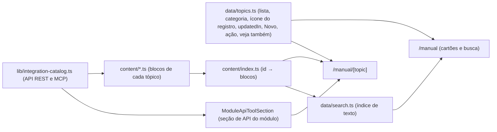

# Manual e ajuda

Descreve o que o código faz **hoje** (frontend, redesenho do Manual de 2026-10-20). O manual é **conteúdo para usuários**: texto claro em português do Brasil, descrevendo o comportamento atual das telas. **O Manual continua em código**: não é editável pelo administrador.

## 1. Objetivo e quem usa

Guia de uso por módulo do Portal Tech V&D, com busca no título **e no texto** dos tópicos. Quem mantém: quem muda o comportamento de uma tela atualiza o tópico correspondente na mesma entrega (texto e campo `updatedIn`).

**A rota exige login.** O `/manual` e o `/manual/[topic]` passam pelo `AuthGuard` como qualquer outra página; só `/login`, `/changelog`, `/reset-password` e `/invite` são abertas. (A versão anterior deste documento supunha que o manual poderia ser público: não é.) Como exige login, o texto pode falar do que a pessoa logada vê, mas **não deve conter dados de pessoas ou da empresa**.

## 2. Telas e entradas

| Rota | O que é |
|---|---|
| `/manual` | Índice: busca (atalho `/`) por título e texto, barra de categorias com contagem, grade larga de cartões agrupada em 5 categorias, estados "Nada encontrado" e carregando |
| `/manual/[topic]` | Tópico: sumário de tópicos fixo à esquerda, texto até 1040 px, coluna da direita (Neste tópico, Veja também, Falar com o suporte), anterior e próximo |
| `/manual#poker` (e outros ids ou apelidos) | Compatibilidade: redireciona para `/manual/poker`. Apelidos em `TOPIC_ALIASES` (`plano`, `seguranca`, `review`, `planejamento`...) |
| `/knowledge/manual` | Ajuda curta **dentro** do módulo Conhecimento (texto separado, em `src/app/knowledge/manual/page.tsx`) |

As guias laterais dos módulos (`PokerGuide`, `HealthGuide`...) apontam para `/manual#id` ou `/manual/id`: **não renomeie ids de tópico** sem atualizá-los (ou acrescente o apelido).

Categorias (ids internos): `ceremonies` Cerimônias, `team` Time e acompanhamento, `knowledge` Conhecimento e IA, `tools` Ferramentas, `account` Conta e ajuda.

Tópicos (21): Scrum Poker, Retrospectiva, Review, Radar de clima, Brainstorming, Planejamento da sprint, Plano de ação, Painel e Squad, Meu espaço, Base de conhecimento, Prompt Hub, Jolt, DevTools, Central de qualidade, Integrações e API, Primeiros passos e papéis, Segurança e dados, Suporte, Versões, Administração, Manifesto.

## 3. Como o manual é montado

O texto de cada tópico é **dado** (uma lista de blocos tipados em `content/types.ts`), não JSX. Por isso o índice de busca, o sumário "Neste tópico" e o tempo de leitura saem do mesmo conteúdo que a página mostra. Blocos: ideia central, seção (`h2`), parágrafo, passo numerado, item, aviso, pergunta comum, código (com botão de copiar), linha de referência de API e a seção de API de um módulo (`module-api`, vinda do catálogo). Marcação nos textos: `**negrito**`, `` `código` `` e `[rótulo](/rota)`.

Para **adicionar um tópico**: (1) item em `DEFS` de `data/topics.ts` com `id`, categoria, `module` (o ícone e o nome vêm do registro de módulos; só tópico sem módulo usa ícone próprio), frase, `updatedIn`, ação, palavras-chave e "veja também"; (2) arquivo em `content/` com os blocos, começando pela ideia central; (3) registrar em `content/index.ts`. Mantenha os tópicos de cada categoria juntos em `DEFS` (a ordem do arquivo é a ordem do anterior e próximo).

### Campos mantidos à mão

- `updatedIn` ("vX.Y.Z"): versão em que o texto foi revisado pela última vez. O teste exige o formato e que não passe da versão do `package.json`.
- `isNew`: etiqueta "Novo" no cartão e no sumário. Tire quando o tópico deixar de ser novidade.

### Endereços da API

O tópico Integrações e API e as seções de API dos módulos (Scrum Poker, Base de conhecimento, Prompt Hub, Painel e Squad) leem `src/lib/integration-catalog.ts`, que espelha os controllers `/api/v1/**` e as ferramentas MCP do backend. Nomes de rota e de ferramenta **não** são escritos à mão nos tópicos.

## 4. O que o redesenho mudou

- Índice com busca no corpo (mostra "No texto: …"), cinco categorias novas, cartões com ícone do módulo, "Atualizado em" e "Novo".
- Página de tópico em colunas (sumário, texto, coluna da direita), com passo a passo, avisos, perguntas comuns e blocos de código.
- Tópicos novos: DevTools, Central de qualidade (filtro Qualidade do DevTools), Plano de ação, Suporte, Versões, Painel e Squad, Administração.
- Corrigidos: Segurança e dados (login próprio com JWT, sessão renovável por até 7 dias, "sair" encerra em todos os aparelhos, tokens e chaves cifrados no servidor, link para `/governance`), Planejamento (módulo ativo, quatro etapas), Scrum Poker (horas por papel, Copiar estimativa, sem subtarefas no Jira), Brainstorming (as cinco etapas reais), Radar de clima (escalas e nota), Meu espaço (seis abas), Jolt (Sandbox e Gerador de spec).
- Removidos: jargão ("Manual de Agilidade & Ferramentas", "Guia de Operações"...), qualquer menção a "engenharia", as 88 cores de paleta fixa dos heros por tópico (agora só tokens do tema).

## 5. Pontos frágeis e o que **não** foi feito

- **O manual não é testado contra as telas.** Os testes cobrem estrutura (ícone do registro, categorias, `updatedIn`, textos proibidos, nomes reais de API, busca, renderização de todos os tópicos), não o comportamento do produto. Texto desatualizado só aparece quando alguém lê. Regra prática: mudou uma tela, mude o tópico e o `updatedIn`.
- **DevTools, Central de qualidade, Suporte e Versões** foram escritos conforme os desenhos aprovados; dependem de entregas de outras frentes (filtro Qualidade e favoritas no DevTools; fechar e reabrir chamado, aviso no sino e nova versão). Conferir o texto quando elas forem para a homologação.
- **"Este tópico ajudou?" é só visual:** a resposta não é gravada nem enviada. Gravar (e medir) exige endpoint novo no backend; não foi feito.
- **Duas ajudas para a Base de conhecimento** (`/manual/knowledge` e `/knowledge/manual`) mantidas à mão; podem divergir.
- `/api/knowledge/sync-manuals` (lê `manual/*.md` do diretório do servidor) não tem chamador e o diretório `manual/` não existe na imagem de produção. Rota morta; exige login.
- O endereço do servidor MCP é `https://SEU-PORTAL/mcp/sse` (o `Caddyfile` do backend roteia `/mcp/*`; exige reiniciar o proxy na VM, ver `chaves-de-api-e-mcp.md`).
- Não verificado ao vivo com login e backend: aparência conferida com uma página temporária (removida) e pelos testes.

## 6. Onde olhar no código

- `src/app/manual/page.tsx`, `layout.tsx`, `loading.tsx`, `[topic]/page.tsx` (título da aba por tópico em `generateMetadata`).
- `src/app/manual/data/topics.ts` (lista e metadados), `data/search.ts` (índice e busca), `data/inline.ts` (marcação), `content/*.ts` (textos).
- `src/app/manual/components/*`: `ManualIndex`, `TopicCard`, `TopicPage`, `TopicNav`, `TopicToc`, `TopicBlocks`, `TopicHelpful`, `ManualCode`, `ModuleApiToolSection`.
- Testes: `src/app/manual/__tests__/topics.test.ts`, `search.test.ts`, `render.test.tsx`; varreduras `src/app/knowledge/__tests__/classes-legadas.test.ts` e `src/lib/__tests__/qa3-contraste.test.ts`.

